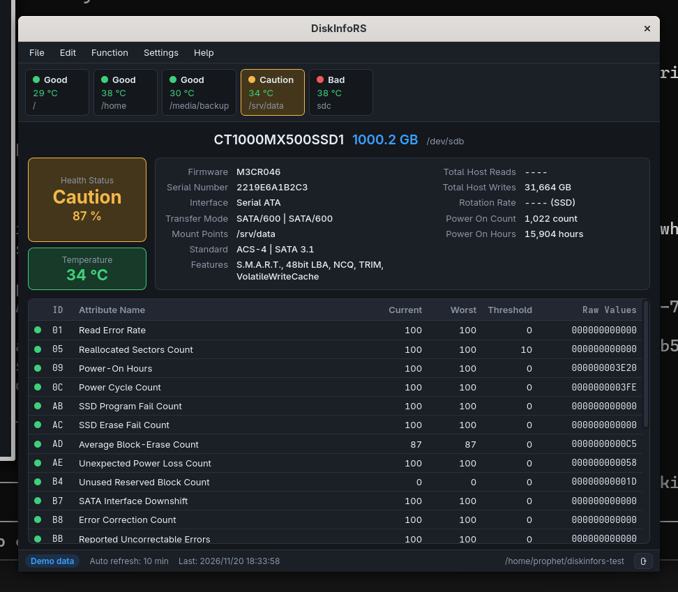
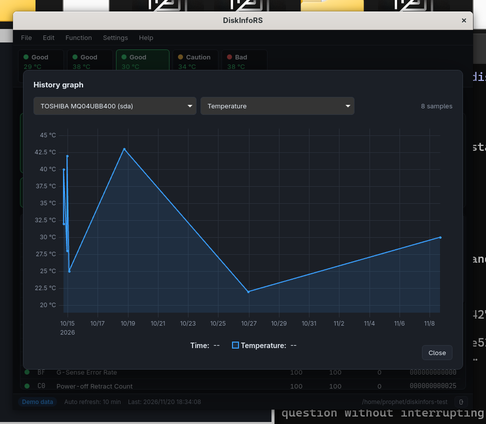

# DiskInfoRS

A dark-themed S.M.A.R.T. disk health viewer for **Linux** and **macOS** in the style of CrystalDiskInfo, written in Rust with Tauri 2.
It ships as a single portable AppImage (x86_64 and aarch64) and as a universal `.dmg` for Intel and Apple silicon Macs.

> Independent clean-room implementation, inspired by CrystalDiskInfo (hiyohiyo / Crystal Dew World) and not affiliated with it.
> No CrystalDiskInfo code, artwork or voices are used.




## Features

- **SATA, USB-SATA (SAT) and NVMe** drives. No `smartctl` needed:
  - Linux: native kernel ioctls, SG_IO with ATA PASS-THROUGH (16)/(12) and the NVMe admin command.
  - macOS: IOKit's ATA and NVMe S.M.A.R.T. user clients (the same interfaces smartmontools uses), including Apple's internal SSDs.
- **Health status** (Good / Caution / Bad / Unknown) and **life %**, using CrystalDiskInfo-style rules:
  - ATA: *Bad* when an attribute value ≤ its threshold, or when SMART RETURN STATUS reports threshold exceeded. *Caution* when the raw value of 05 / C5 / C6 reaches its alarm threshold (default 1), or when SSD life ≤ 10 %.
  - NVMe: *Bad* on critical-warning bits 0/2/3 or when available spare is below its threshold. *Caution* on bits 1/4, or when percentage used ≥ 90 %.
  - Alarm thresholds can be changed per disk (*Function → Alarm thresholds…*).
- **Temperature** with per-type alarm colours (HDD 50/55 °C, SATA SSD 60/70 °C, NVMe 70/80 °C), shown in °C or °F.
- **Drive details**: firmware, serial (can be hidden), interface, SATA/PCIe link mode, ATA/SATA or NVMe standard, features (S.M.A.R.T., APM, AAM, NCQ, TRIM, DevSleep, VolatileWriteCache…), rotation rate, power-on hours and count, host reads/writes and NAND writes.
- Vendor-aware attribute names for Samsung, Crucial/Micron, Intel, WD/SanDisk, Kingston/Phison and Toshiba/Kioxia.
- **History graphs** of any attribute, temperature, life, host writes and more. Double-click a table row to open one.
- **Auto refresh** (1 min – 24 h), **copy report** to clipboard, raw values in hex or decimal.
- **Read-only fallback** on Linux without root: shows model, serial, size, mount points and hwmon temperature from sysfs.

## Portability

On Linux, all state lives next to the AppImage, the same way the CrystalDiskInfo portable edition keeps it next to the exe:

```
DiskInfoRS-0.1.0-x86_64.AppImage
DiskInfo.ini          settings and per-disk alarm thresholds
Smart/<Model><Serial>/Smart.ini, *.csv   S.M.A.R.T. history
```

If that folder isn't writable (for example a read-only USB stick), DiskInfoRS falls back to `~/.config/DiskInfoRS`.

On macOS, the data lives in `~/Library/Application Support/DiskInfoRS`. To run portable, put a `DiskInfo.ini` (it can be empty) or a `Smart` folder next to `DiskInfoRS.app`, and DiskInfoRS uses that folder instead.

On both systems, `DISKINFORS_DATA_DIR=/some/dir` overrides the location. *Help → About* shows the folder in use.

### Importing CrystalDiskInfo history

The `Smart/` folder uses **CrystalDiskInfo's file format**: `Smart.ini` sections plus `date,value` CSV files. Copy your Windows `CrystalDiskInfo\Smart` folder into the data folder and the graphs will continue your existing history.

## Running

### Linux

```sh
chmod +x DiskInfoRS-*.AppImage
./DiskInfoRS-*.AppImage           # normal start
./DiskInfoRS-*.AppImage --demo    # sample disks (Good / Caution / Bad), no hardware access
./DiskInfoRS-*.AppImage --disk sdb --graph   # preselect a disk and open its history graph
```

### macOS

Open the `.dmg` and drag **DiskInfoRS** to *Applications*. The app is ad-hoc signed but not notarized, so the first time macOS says it can't verify the developer.
Either right-click the app and choose **Open** (on macOS 15 and later: *System Settings → Privacy & Security → Open Anyway*), or remove the quarantine flag:

```sh
xattr -dr com.apple.quarantine /Applications/DiskInfoRS.app
```

The command-line options work too: `/Applications/DiskInfoRS.app/Contents/MacOS/diskinfors --demo`.

macOS needs **no password**: IOKit's S.M.A.R.T. interfaces work for normal users, so the status bar shows *Full access (IOKit)*.
macOS has no ATA pass-through for USB, so USB and Thunderbolt enclosures show their model and size but no S.M.A.R.T. data (unless a third-party SAT driver adds it).

### Privileges (Linux)

Raw S.M.A.R.T. commands need root (CAP_SYS_RAWIO). The GUI always runs as your user:

1. On start (or with **Elevate** in the status bar), DiskInfoRS runs its small, statically linked `diskinfo-helper` through **pkexec**. Your desktop asks for your password once per session.
2. The helper only understands `scan` and `quit`. It never takes paths or other arguments from the GUI, and it exits when the GUI closes.
3. AppImages run from a FUSE mount that root can't read, so the helper is first copied to `$XDG_RUNTIME_DIR/diskinfors-<uid>/` (mode 0700).
4. If you cancel, the app stays in **Read-only** mode.
5. If DiskInfoRS is already started as root, it reads devices directly without the helper.

You can turn off *Settings → Elevate on start* to always start in read-only mode.

The helper also works on its own for scripting:

```sh
sudo ./diskinfo-helper --dump        # JSON of all disks
```

## Downloads

Prebuilt AppImages (x86_64, aarch64) and the universal macOS `.dmg` are attached to each [GitHub release](../../releases). They are built by GitHub Actions from the tagged source.

## Building

### Linux

Requirements: Rust (rustup; `build.sh` adds the `<arch>-unknown-linux-musl` target), Node.js ≥ 18, `tauri-cli` 2, WebKitGTK 4.1 / GTK 3 development packages, `patchelf`, `file`.

Fedora:

```sh
sudo dnf install webkit2gtk4.1-devel gtk3-devel libsoup3-devel librsvg2-devel librsvg2-tools \
                 openssl-devel libappindicator-gtk3-devel gcc gcc-c++ musl-gcc patchelf file nodejs npm
```

Debian/Ubuntu:

```sh
sudo apt install libwebkit2gtk-4.1-dev libgtk-3-dev librsvg2-dev librsvg2-bin libssl-dev \
                 libayatana-appindicator3-dev build-essential musl-tools patchelf file nodejs npm
```

Then:

```sh
rustup target add x86_64-unknown-linux-musl
cargo install tauri-cli --version '^2' --locked

./build.sh            # -> dist/DiskInfoRS-0.1.0-<arch>.AppImage (x86_64 or aarch64, same as the host)
./build.sh test       # unit tests, svelte-check, clippy
./build.sh dev        # debug build and run with demo data
./build.sh icons      # re-render the icons after editing icons/icon.svg (needs rsvg-convert)
```

For maximum compatibility with older distros, build on the **oldest** distro you want to support, because the AppImage still uses the host's glibc. The release workflow builds on Ubuntu 22.04.

### macOS

Requirements: Xcode command line tools (`xcode-select --install`), Rust (rustup), Node.js ≥ 18, `tauri-cli` 2.

```sh
cargo install tauri-cli --version '^2' --locked

./build.sh            # -> dist/DiskInfoRS-0.1.0-macos-universal.dmg (Intel + Apple silicon)
MAC_TARGET=aarch64-apple-darwin ./build.sh   # single-arch build, faster
./build.sh test
./build.sh dev
```

### Releases

Push a version tag (`git tag v0.1.0 && git push origin v0.1.0`). The *Release* workflow builds all three packages and attaches them, with `SHA256SUMS`, to a **draft** release that you review and publish. Keep the version in `Cargo.toml`, `app/src-tauri/tauri.conf.json` and `app/ui/package.json` in sync with the tag.

## Layout

```
crates/smart-core   S.M.A.R.T. library: parsers, health rules, and the platform backends
                    (Linux: sysfs + SG_IO / NVMe ioctls, macOS: IOKit in macos.rs)
crates/helper       diskinfo-helper: privileged reader (Linux), JSON lines over stdio; --dump works everywhere
app/src-tauri       Tauri backend: settings, history, helper lifecycle, auto refresh
app/ui              Svelte 5 + TypeScript dark UI, uPlot graphs
```

## Verifying on real hardware

WSL and most VMs don't pass ATA/NVMe commands through, so check on a real Linux machine (or a live USB) and compare against smartmontools:

1. Start the AppImage, click **Elevate** and enter your password. The badge should read *Elevated (helper)*.
2. For each disk, compare model, serial, firmware, power-on hours and count, and temperature with `sudo smartctl -a /dev/XXX`.
3. Compare the attribute table (ID, current, worst, threshold, raw) with `smartctl -A`. For NVMe, compare with the "SMART/Health Information" section.
4. Check that a USB-SATA enclosure shows as `USB (Serial ATA)` with attributes. Bridges without SAT support show an explanatory message instead.
5. Press F5 a few times, open *Function → Graph*, and check that `Smart/<Model><Serial>/` was created next to the AppImage.

On macOS, compare with `smartctl -a disk0` (Homebrew `smartmontools`). The status bar should read *Full access (IOKit)*, and the history goes to `~/Library/Application Support/DiskInfoRS/Smart/`.

## Not yet supported

Vendor-specific USB bridge protocols (JMicron/Realtek/ASMedia NVMe-USB), RAID controllers (MegaRAID, VROC), S.M.A.R.T. over USB on macOS, e-mail and sound alerts, tray mode, translations, notarized macOS builds and Windows.

## License

[MIT](LICENSE)
